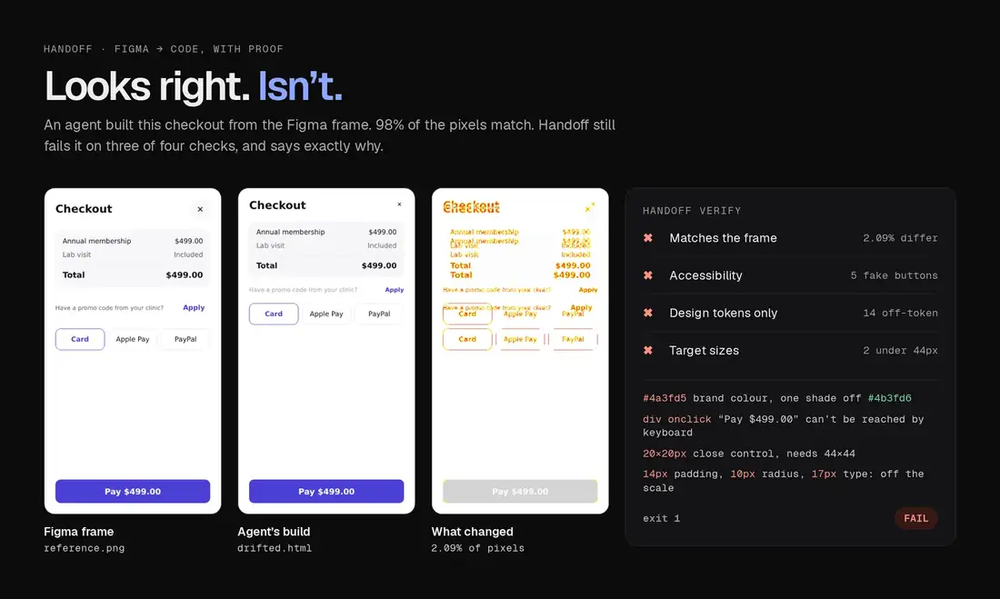

# Handoff

**Figma to code, with proof.** An agent skill that lints a Figma frame before any code is written, builds it with design tokens only, then proves the result matches: pixel diff against the frame, WCAG 2.2 AA, and an audit of every colour, spacing, radius and font size on the rendered page.



## Why

AI design-to-code output usually *looks* right. Then you inspect it:

- the brand colour is `#4a3fd5`, one shade off the `#4b3fd6` token
- the padding is 14px on a 4/8/12/16 scale
- the Pay button is a `div` with an `onclick`, so a keyboard user can't pay
- the close icon is 20×20px

None of that shows up in a screenshot comparison, and all of it ships. Handoff makes the agent prove the details, and it catches the design's own mistakes before they become code.

## How it works

| Step | Command | What it does |
|---|---|---|
| 1. Get the design | `handoff pull <figma-url>` | Saves the frame as node JSON, its variables, and a PNG export. Without a Figma token, the skill uses the Figma MCP server instead. |
| 2. Lint the design | `handoff lint design.json --tokens variables.json` | Finds where the frame breaks its own system, and suggests the token to use instead. |
| 3. Build with tokens | `handoff tokens variables.json > tokens.css` | Turns Figma variables into CSS custom properties, so the agent writes `var(--space-4)`, not `16px`. |
| 4. Verify, then loop | `handoff verify page.html --ref frame.png --tokens variables.json` | Renders the page and checks it four ways. The agent fixes and reruns until it passes. |

### What the design lint checks

```text
$ handoff lint design.json --tokens variables.json
✖ small-target       Close button is 20×20px, below the 24px minimum (WCAG 2.5.8)
                     → Grow the hit area to at least 44×44px.
✖ low-contrast       Promo hint: contrast 2.56:1, needs 4.5:1 (body text, 13px)
                     → Use "color/muted" (#5f5f68), which reaches 6.3:1 here.
✖ off-palette-color  Pay button fill #4a3fd5 is not in the palette
                     → Closest token is "color/brand" (#4b3fd6).
▲ off-grid-spacing   Order summary padding-left is 18px
                     → Nearest step on the spacing scale is 16px.
▲ missing-states     Button component set has no focus or disabled variant
                     → Add focus and disabled variants so the code has a design to follow.

5 errors, 13 warnings, 1 note
```

| Rule | Catches |
|---|---|
| `off-palette-color` | A fill or stroke that isn't a colour token. Suggests the closest one, and for text, the closest one that passes contrast. |
| `unbound-color` | The right value, but not linked to the variable, so a theme change won't reach it. |
| `off-grid-spacing` | Auto layout gap or padding off the spacing scale (or off a 4px grid if there are no spacing tokens). |
| `off-scale-radius`, `off-scale-type` | Corner radii and font sizes outside their scales. |
| `low-contrast` | Text below WCAG AA (4.5:1, or 3:1 for large text), measured against the actual layer behind it. |
| `small-target` | Interactive layers under 24px (WCAG 2.5.8, error) or 44px (warning). |
| `missing-states` | Button-like component sets with no focus or disabled variant. |
| `no-auto-layout` | Frames whose children are positioned by hand. |

### What verify checks

1. **Visual match.** Pixel diff against the Figma export, written to `diff.png`. Default limit: 2% of pixels.
2. **Accessibility.** axe-core at WCAG 2.2 AA, plus elements that respond to clicks but can't be reached by keyboard (`div onclick`), which axe doesn't catch.
3. **Tokens only.** Reads computed styles from the rendered DOM, so it works for React, Vue, Svelte, Tailwind or plain CSS. Browser defaults and `auto` margins are ignored.
4. **Target sizes.** Every interactive element under 44px.

Exit code 0 means everything passes, so it drops straight into CI.

## Use it

### As an agent skill (Claude Code, and any agent that reads SKILL.md)

```bash
git clone https://github.com/mrunaliyadavps/handoff
cp -r handoff/skills/handoff ~/.claude/skills/   # or .claude/skills/ in your project
```

Then ask: *"Build this Figma frame: https://www.figma.com/design/…?node-id=12-34"*. The skill tells the agent to lint first, ask you about the errors, build with tokens, and loop on verify until it passes. For Cursor or other agents, point your rules file at `skills/handoff/SKILL.md`.

### As a CLI

```bash
npx -y github:mrunaliyadavps/handoff lint design.json --tokens variables.json
npx playwright install chromium   # once, for verify
npx -y github:mrunaliyadavps/handoff verify http://localhost:3000/checkout --ref frame.png --scale 2 --tokens variables.json
```

`--format md` prints a Markdown report for pull requests; `--format json` prints everything.

### In CI

```yaml
- uses: mrunaliyadavps/handoff@main
  with:
    target: http://localhost:3000/checkout
    reference: design/checkout.png
    tokens: design/variables.json
```

The report lands in the job summary, and the step fails when the UI drifts.

### Getting the design out of Figma

- **With a token:** set `FIGMA_TOKEN` (a personal access token with `file_content:read`), then `handoff pull "<frame url>"`. The Variables REST API needs a Figma plan that includes it; without it, lint falls back to a 4px grid and you can pass tokens from your codebase instead.
- **Without a token:** in an agent with the [Figma MCP server](https://developers.figma.com/docs/figma-mcp-server/), the skill uses `get_screenshot`, `get_variable_defs`, and runs [`extract-figma.js`](skills/handoff/extract-figma.js) (read-only) through `use_figma` to export the frame in the same shape as the REST API.
- **Tokens** can be Figma variables JSON, the output of `get_variable_defs`, or a flat map like `{ "color/brand": "#4b3fd6", "space/4": 16 }`.

## Try the example

```bash
npm install && npx playwright install chromium
npm test        # builds the example fixtures, then runs the tests
npm run demo
```

[`examples/checkout`](examples/checkout) holds a checkout frame as handed off (`design.json`, with the usual mistakes), the same frame after the designer's fixes (`design-fixed.json`), its variables, a faithful build (`good.html`, passes) and a build that only looks right (`drifted.html`, fails). The frame export `reference.png` is rendered on your machine by `examples/build-fixture.mjs`, so pixel comparisons don't depend on another computer's fonts.

## Status and honesty

This is v0.1. The example fixtures are generated from an HTML mock of a Figma frame ([`examples/build-fixture.mjs`](examples/build-fixture.mjs)) in the REST API's node format, and `extract-figma.js` is tested against a mock of the Figma Plugin API. `handoff pull` follows the documented REST endpoints but hasn't been run against every plan type yet. Issues and real-world frames that trip it up are very welcome.

Ideas for next: mobile and tablet frames in one run, React Native and SwiftUI verifiers, Code Connect awareness so it checks component usage, and a PR comment bot.

## Licence

MIT © Mrunali Yadav
